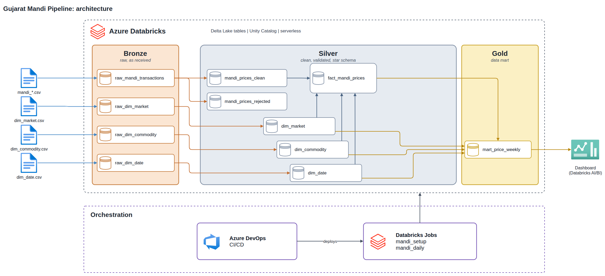
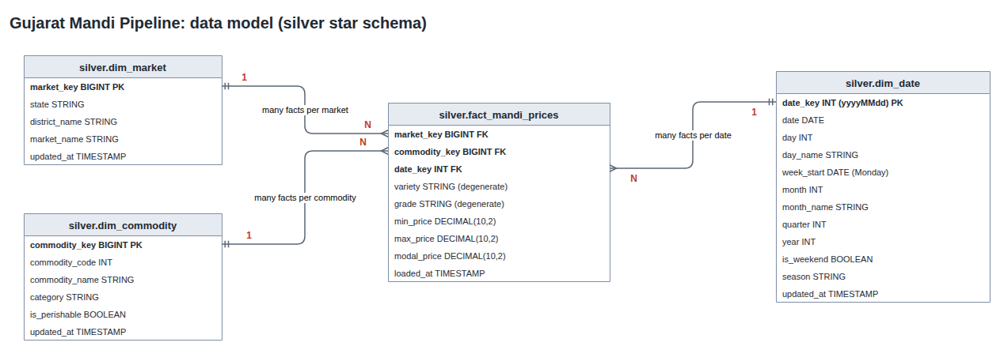
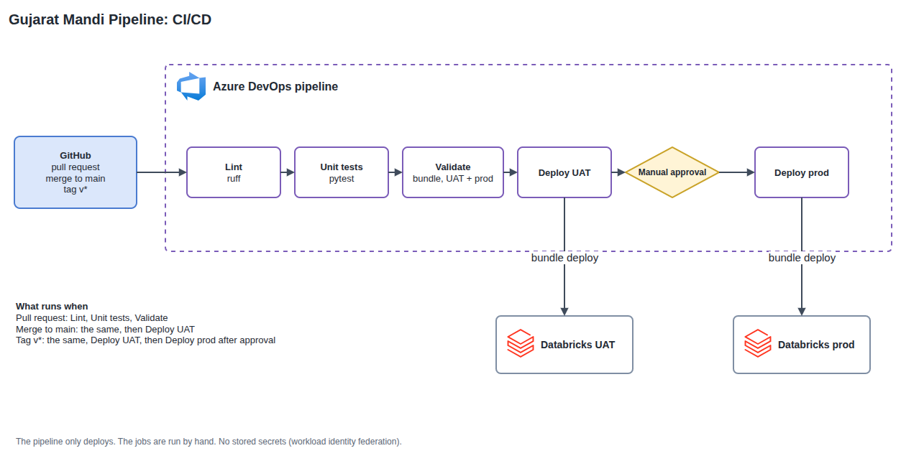
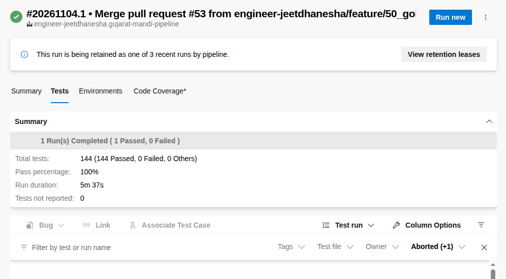
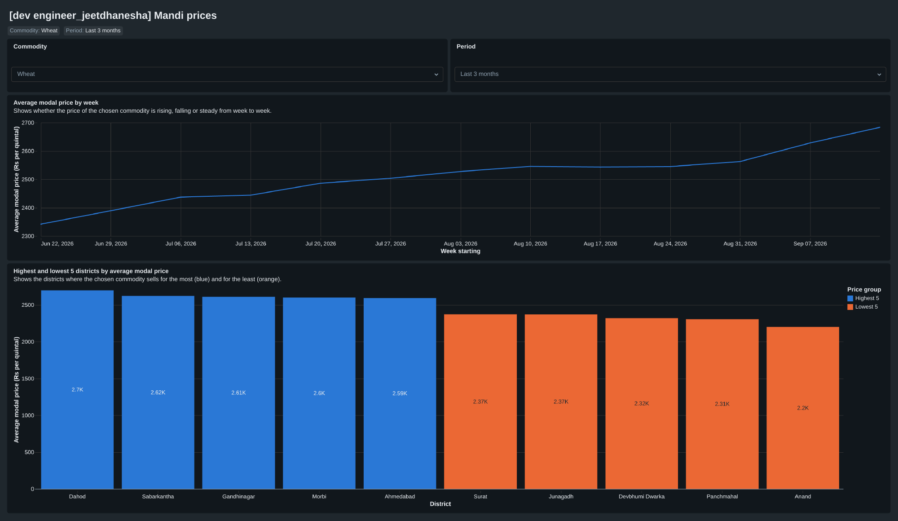

# Gujarat Mandi Pipeline

## Overview

- Loads daily mandi (market) prices of Gujarat, cleans them and shows them in a dashboard.
- Built on Azure Databricks (Bronze, Silver, Gold).
- Bad rows are kept aside with a reason.
- Deployed as code with a Databricks Asset Bundle and an Azure DevOps CI/CD pipeline.

## Input source

- Input is a CSV file, one row per price report.
- One row = market x commodity x variety x grade x date.
- The file is uploaded to a Databricks volume `landing_zone`. The `mandi_daily` job then loads it into the tables.
- Sample files in `sample_data/`: a one-day file (`mandi_2026-01-01.csv`) and the full file for 2026 as a zip (unzip it before uploading).
- Source of the data: [data.gov.in, daily mandi prices](https://www.data.gov.in/resource/current-daily-price-various-commodities-various-markets-mandi).

| Column | What it means |
|---|---|
| State | State name (always Gujarat) |
| District | District of the market (spelling can vary) |
| Market | Name of the market (APMC yard) |
| Commodity | Product sold |
| Commodity_Code | Code of the commodity |
| Variety | Variety of the product |
| Grade | Quality grade |
| Arrival_Date | Date of the price, `dd/MM/yyyy` |
| Min_Price | Lowest price of the day, rupees per quintal (100 kg) |
| Max_Price | Highest price of the day, rupees per quintal |
| Modal_Price | Most common price of the day, rupees per quintal |

Sample rows:

| State | District | Market | Commodity | Commodity_Code | Variety | Grade | Arrival_Date | Min_Price | Max_Price | Modal_Price |
|---|---|---|---|---|---|---|---|---|---|---|
| Gujarat | Banaskanth | Amirgadh APMC | Wheat | 1 | Other | FAQ | 01/01/2026 | 2505 | 2650 | 2650 |
| Gujarat | Morbi | APMC HALVAD | Cotton | 15 | Local | Local | 01/01/2026 | 6000 | 7860 | 6975 |
| Gujarat | Morbi | APMC HALVAD | Groundnut | 10 | Other | Local | 01/01/2026 | 5500 | 8150 | 6850 |

## High level architecture



- **Price file:** 1 CSV file, uploaded to the volume `landing_zone`.
- **Dimension files:** 3 CSV files (`dim_market`, `dim_commodity`, `dim_date`) stored in the code repo under `seed/`.
- **Flow of the price file:** volume -> Bronze (raw, with file name and run id) -> Silver clean + rejected -> data modeling (fact and dimensions) -> Gold data mart.
- **Flow of the dimension files:** `seed/` -> Bronze -> Silver dimensions.
- **Silver:** failed rows go to the rejected table with the rule and the reason.
- **Gold:** one weekly price table that the dashboard reads.
- **Orchestration:** two Databricks jobs, `mandi_setup` (once) and `mandi_daily` (per source file). Azure DevOps deploys them.

## Data model



- Star schema in Silver, modelled the Kimball way.
- **Fact table `fact_mandi_prices`:** a transaction fact table.
  - **Grain:** one row per market, commodity, variety, grade and date.
  - **Foreign keys:** `market_key`, `commodity_key`, `date_key` (surrogate keys of the dimensions).
  - **Degenerate dimensions:** `variety` and `grade` (descriptive, kept in the fact table, no dimension table of their own).
  - **Measures:** `min_price`, `max_price`, `modal_price` (rupees per quintal). They are non-additive: a price is averaged, not summed.
  - **Load:** `MERGE` on the natural key, so a day loaded twice is updated, not duplicated.
- **Dimension tables** (conformed, loaded from the CSV files in `seed/`):
  - `dim_market`: one row per market, with its standard district name (`market_key`).
  - `dim_commodity`: one row per commodity, with category and perishable flag (`commodity_key`).
  - `dim_date`: one row per calendar day, with week start, month, quarter, year, weekend flag and season (`date_key`).
  - Each has a surrogate key and a natural key. They are Type 1: a change in the seed file overwrites the row.
- Every column and type: [`docs/table-structure.md`](docs/table-structure.md).

## CI/CD process



| Stage | What it does |
|---|---|
| Lint | Runs `ruff` on the code: finds unused or undefined names and unsorted imports |
| Unit tests | Runs the `pytest` tests of the `lib_mandi` library on a local Spark with Delta, and publishes the results |
| Validate | Runs `databricks bundle validate` for UAT and prod, to check the bundle against the real workspaces without deploying |
| Deploy UAT | Runs `databricks bundle deploy` to upload the notebooks, library, jobs and dashboard to the UAT workspace |
| Approval | Waits for a person to approve the prod release |
| Deploy prod | Runs `databricks bundle deploy` to the prod workspace |

- Code is on GitHub, the pipeline runs on Azure DevOps. The pipeline only deploys; the jobs are run by hand.

## Testing

| Level | Where it runs | What it checks |
|---|---|---|
| Unit tests (`tests/unit`) | CI pipeline, on a local Spark with Delta | The `lib_mandi` functions: extract, transform, data quality rules, load (`MERGE`), config |
| Notebook tests (`tests/test_*.ipynb`) | Databricks, run by hand in dev | One test per notebook (setup, bronze, silver dimensions, silver transactions, silver facts, gold) |

- Unit test results are published to the Tests tab of every pipeline run:



## Repository layout

```
.
├── README.md
├── databricks.yml              bundle: variables and the dev, uat, prod targets
├── azure-pipelines.yml         CI/CD pipeline
├── azure-pipelines/templates/  reusable pipeline steps
├── resources/
│   ├── mandi_setup.yml         job: create tables, load dimensions
│   ├── mandi_daily.yml         job: load bronze, silver, gold, then archive the file
│   ├── dashboards.yml          dashboard settings
│   └── dashboards/             dashboard definition (.lvdash.json)
├── src/
│   ├── *.ipynb                 notebooks (read widgets, call the library)
│   └── lib_mandi/              the code: extract, transform, load, quality rules, table definitions
├── tests/
│   ├── unit/                   unit tests (run in CI)
│   └── test_*.ipynb            notebook tests (run on Databricks)
├── seed/                       dimension CSV files
├── sample_data/                sample price files to try the pipeline
├── docs/                       diagrams, table structure, decisions, quality rules
└── ruff.toml, pytest.ini, requirements-dev.txt
```

- More docs: [`decisions`](docs/decisions.md), [`data quality rules`](docs/data-quality-rules.md).

## Dashboard



- **Parameters:** Commodity (default Wheat) and Period (current week, last 2 weeks, last month, last 3 months; default last 3 months). Only complete weeks are counted.
- **Chart 1, weekly price trend:** a line of the average modal price per week for the chosen commodity (the average of the district weekly averages).
- **Chart 2, highest and lowest districts:** columns of the 5 districts with the highest (blue) and the 5 with the lowest (orange) average modal price over the chosen period, sorted high to low.
