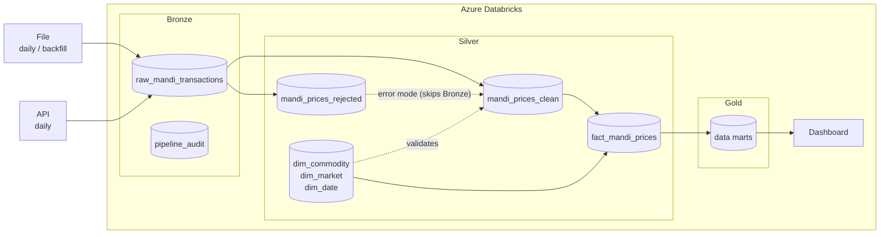

# Gujarat Mandi Pipeline

A data pipeline and dashboard for daily commodity prices in Gujarat's APMC mandis (agricultural markets). Prices are ingested from the Government of India open data platform, cleaned through a Bronze → Silver → Gold medallion architecture on Azure Databricks, and served in a dashboard.

> **Status:** in progress. The table design and high-level design are done (`docs/`), the Bronze file load and the Silver dimension tables are built. The rest of Silver, Gold, CI/CD and the dashboard are planned (see [Roadmap](#roadmap)).

## Contents

- [Overview](#overview)
- [Data source](#data-source)
- [Architecture](#architecture)
- [Data model](#data-model)
- [Pipeline run modes](#pipeline-run-modes)
- [Data quality and rejected rows](#data-quality-and-rejected-rows)
- [Sample data](#sample-data)
- [Environments and CI/CD](#environments-and-cicd)
- [Configuration](#configuration)
- [Repository layout](#repository-layout)
- [Roadmap](#roadmap)
- [Contributing](#contributing)

## Overview

Mandi prices are published daily but are messy: district names are misspelt, commodity names carry stray line breaks, and some rows have impossible prices. This project:

1. Loads the raw data exactly as received (Bronze).
2. Cleans, standardises and validates it against the market and commodity dimensions, keeping bad rows aside for review, and models it as a star schema (Silver).
3. Builds data marts for analysis (Gold).
4. Shows price trends by commodity, market and district in a Databricks dashboard.

Scope is mandi prices only; weather data is out of scope for now.

## Data source

| | |
|---|---|
| **Dataset** | [Current Daily Price of Various Commodities from Various Markets (Mandi)](https://www.data.gov.in/resource/current-daily-price-various-commodities-various-markets-mandi) on data.gov.in |
| **API** | `https://api.data.gov.in/resource/35985678-0d79-46b4-9ed6-6f13308a1d24`, filtered to `State = Gujarat`, paged at 1,000 rows |
| **Access** | Needs a free data.gov.in API key. The key is kept in a Databricks secret scope and is never committed. |
| **Grain** | One row per market × commodity × variety × grade × arrival date |
| **Refresh** | Daily |
| **Prices** | Rupees per quintal (100 kg): minimum, maximum and modal (most common) |

Fields as received: `State`, `District`, `Market`, `Commodity`, `Commodity_Code`, `Variety`, `Grade`, `Arrival_Date` (`dd/MM/yyyy`), `Min_Price`, `Max_Price`, `Modal_Price`.

Known quirks the pipeline has to handle:

- District spellings vary (for example `Banaskanth`), so each market's standard district name comes from `dim_market`.
- Commodity names can contain `\n`, and 6 commodity codes have two spellings; each code gets one standard name in `dim_commodity`.
- `Variety` is often just `Other`.
- Prices can arrive as decimals, as non-numbers, or in the wrong order (min > max).

## Architecture

The full diagram, with tech-stack logos, is in [`docs/high-level-design.html`](docs/high-level-design.html) (open it in a browser). A simplified copy:



| Concern | Technology |
|---|---|
| Pipeline and dashboard | Azure Databricks |
| Storage | Delta Lake tables, governed by Unity Catalog |
| CI/CD | Azure DevOps |
| Source control | GitHub |

## Data model

Catalogs are `mandi_dev` and `mandi_prod`, each with schemas `bronze`, `silver` and `gold`. Full column lists, types and keys are in [`docs/table-structure.md`](docs/table-structure.md).

| Layer | Table | Purpose |
|---|---|---|
| Bronze | `raw_mandi_transactions` | Raw rows, all `STRING`, append-only, with lineage columns (`_run_id`, `_source_mode`, `_file_name`, …) |
| Bronze | `pipeline_audit` | One row per pipeline run: mode, business date range, status, row counts |
| Silver | `mandi_prices_clean` | Typed, standardised, de-duplicated; `MERGE` target. Natural key: market + commodity code + variety + grade + arrival date |
| Silver | `mandi_prices_rejected` | Rows that failed a quality rule, with the reason and a review status |
| Silver | `dim_market`, `dim_commodity`, `dim_date` | Dimensions with surrogate keys, loaded from the CSV files in `seed/` |
| Silver | `fact_mandi_prices` | Prices at market × commodity × variety × grade × date, derived from clean. Variety and grade are degenerate dimensions on the fact |
| Gold | `mart_price_weekly` | Weekly min, max and average price per district × commodity, with week-on-week change; updated incrementally per run. More marts are planned |

The dimensions are the reference data: a market or commodity that is not in `seed/` is rejected, not added automatically. To add one, edit the CSV and run the seed again (`src/load_silver_dims`), then repair the rejected rows.

## Pipeline run modes

Every run records its mode in `_source_mode` (`API`, `FILE` or `BACKFILL`) and writes one row to `bronze.pipeline_audit`.

| Mode | Input | Path | When |
|---|---|---|---|
| **File** | A file with one day of data | Bronze → Silver → Gold marts | Daily |
| **API** | One day of data from the API | Bronze → Silver → Gold marts | Daily |
| **Backfill** | A file only; may hold many days | Bronze → Silver → Gold marts, for every date in the file | On demand, to load history |
| **Error** | Rows in `silver.mandi_prices_rejected` with status `RESOLVED` | **Skips Bronze.** Reads the resolved rows directly from Silver and loads them into the target (`mandi_prices_clean`, then the fact table) | After someone has fixed rejected rows |

How the audit row describes each run:

- `business_start_date` / `business_end_date` are the first and last `arrival_date` the run covers. For a daily run they are equal; for a backfill they span the file.
- `status` moves `RUNNING` → `SUCCESS` or `FAILED`; `error_message` is filled on failure.
- `source_total_rows` and `source_rows_rejected` give the volume and how many rows went to the rejected table.

Because Silver is a `MERGE` on the natural key, re-running a day or a backfill updates existing rows instead of duplicating them.

## Data quality and rejected rows

Rows are rejected (not dropped) when any of these rules fail, so nothing is silently lost:

- Date is null or can't be parsed.
- Any price is null or can't be parsed, or is zero or negative.
- Min price is greater than max price.
- Modal price is outside the min–max range.
- Market or commodity code is missing.
- Market is not in `dim_market`, or commodity code is not in `dim_commodity`.
- Arrival date is in the future, or is not in `dim_date`.
- Another row of the same run has the same natural key (a duplicate). The latest row is kept; the others are rejected with status `REJECTED`, since there is nothing to fix.

Every failing rule is recorded, as comma separated ids in `reject_rule`.

Each rejected row keeps its raw values plus `reject_rule`, `reject_reason` and a `status`:

```
ERROR ──(fixed and marked)──▶ RESOLVED ──(error mode)──▶ mandi_prices_clean
  └────(not fixable)───────▶ REJECTED
```

`ERROR` means pending a decision, `RESOLVED` means fixed and ready to be loaded by error mode, `REJECTED` means it stays out for good, and `LOADED` means it was repaired and merged into clean.

## Sample data

The values below are **illustrative**, shaped like the real data. They are not pulled from the live API, which needs a key.

**1. Bronze: `raw_mandi_transactions`** (as received, all text)

| state | district | market | commodity | commodity_code | variety | grade | arrival_date | min_price | max_price | modal_price | _source_mode | _run_id |
|---|---|---|---|---|---|---|---|---|---|---|---|---|
| Gujarat | Banaskanth | Palanpur | Castor Seed | 21 | Other | FAQ | 11/10/2026 | 6100 | 6450 | 6300 | API | run_0001 |
| Gujarat | Rajkot | Rajkot | Groundnut | 5 | Other | Local | 11/10/2026 | 5400 | 6200 | 5800 | API | run_0001 |
| Gujarat | Mehsana | Unjha | Cumin Seed(Jeera) | 12 | Other | FAQ | 11/10/2026 | 0 | 24500 | 24000 | API | run_0001 |

**2. Silver: `mandi_prices_clean`** (typed and standardised)

| district | district_std | market | commodity_code | commodity | variety | grade | arrival_date | min_price | max_price | modal_price |
|---|---|---|---|---|---|---|---|---|---|---|
| Banaskanth | Banaskantha | Palanpur | 21 | Castor Seed | Other | FAQ | 2026-10-11 | 6100.00 | 6450.00 | 6300.00 |
| Rajkot | Rajkot | Rajkot | 5 | Groundnut | Other | Local | 2026-10-11 | 5400.00 | 6200.00 | 5800.00 |

**3. Silver: `mandi_prices_rejected`** (the third raw row above, with a zero min price)

| market | commodity_code | arrival_date | min_price | max_price | modal_price | reject_rule | reject_reason | status |
|---|---|---|---|---|---|---|---|---|
| Unjha | 12 | 11/10/2026 | 0 | 24500 | 24000 | price_le_zero | Min price is zero or negative | ERROR |

After someone corrects the price and sets `status = RESOLVED`, an error-mode run loads it into `mandi_prices_clean`.

**4. Silver: `fact_mandi_prices`** (keys point to the dimensions)

| market_key | commodity_key | date_key | variety | grade | min_price | max_price | modal_price |
|---|---|---|---|---|---|---|---|
| 17 | 3 | 20261011 | Other | FAQ | 6100.00 | 6450.00 | 6300.00 |

**5. Bronze: `pipeline_audit`**

| run_id | source_mode | business_start_date | business_end_date | status | source_total_rows | source_rows_rejected |
|---|---|---|---|---|---|---|
| run_0001 | API | 2026-10-11 | 2026-10-11 | SUCCESS | 3 | 1 |

## Environments and CI/CD

- **Environments:** `mandi_dev` for development and testing, `mandi_prod` for the scheduled production run.
- **CI/CD (planned):** Azure DevOps builds, tests and deploys the pipeline to Databricks, promoting from dev to prod.
- **Scheduling (planned):** the daily File/API run is a Databricks job; Backfill and Error runs are started on demand with a mode parameter.

## Configuration

Planned inputs; names may change when the code is written.

| Setting | Purpose |
|---|---|
| `catalog` | `mandi_dev` or `mandi_prod` |
| `mode` | `file`, `api`, `backfill` or `error` |
| `arrival_date` | The day to load (File and API modes) |
| API key | data.gov.in key, stored as a Databricks secret, never in the repo |

## Repository layout

```
.
├── README.md
├── docs/
│   ├── table-structure.md        Table design (source of truth)
│   ├── table-structure.html      Same, rendered for reading
│   └── high-level-design.html    Architecture diagram with tech stack
├── seed/                         CSV files for the silver dimensions
├── src/
│   ├── *.py                      Databricks notebooks: setup, utility, load_bronze, load_silver_dims, load_silver_transactions, load_silver_facts, load_gold
│   │                             (widgets, table reads, MERGE/writes; call lib_mandi)
│   └── lib_mandi/                transformations, schemas, read options and data quality rules (no Databricks globals)
├── tests/
│   ├── test_*.py                 pytest notebooks run on Databricks, one per source notebook
│   └── unit/                     pytest on the transforms with a local Spark session (for CI)
├── pytest.ini
└── requirements-dev.txt
```

Run the unit tests without Databricks (needs Java 17+ for local Spark):

```
pip install -r requirements-dev.txt
pytest
```

## Roadmap

- [x] Table structure
- [x] High-level design diagram
- [x] README
- [x] Bronze load, single-day file (#25)
- [x] Silver dimension tables and seed files (#27)
- [ ] Bronze load (API, Backfill)
- [x] Silver clean and rejected tables (#30)
- [ ] Error-mode reprocessing
- [x] Silver fact table (#34)
- [ ] Silver post-load checks
- [ ] Pipeline audit table
- [ ] Gold weekly price mart (#32)
- [ ] More gold marts
- [ ] Dashboard
- [ ] Azure DevOps CI/CD

## Contributing

Work is tracked in GitHub issues. Create a branch per issue named `feature/<issue-number>_<short_description>` (for example `feature/22_create_initial_project_plan`), open a pull request into `main`, and link the issue.
